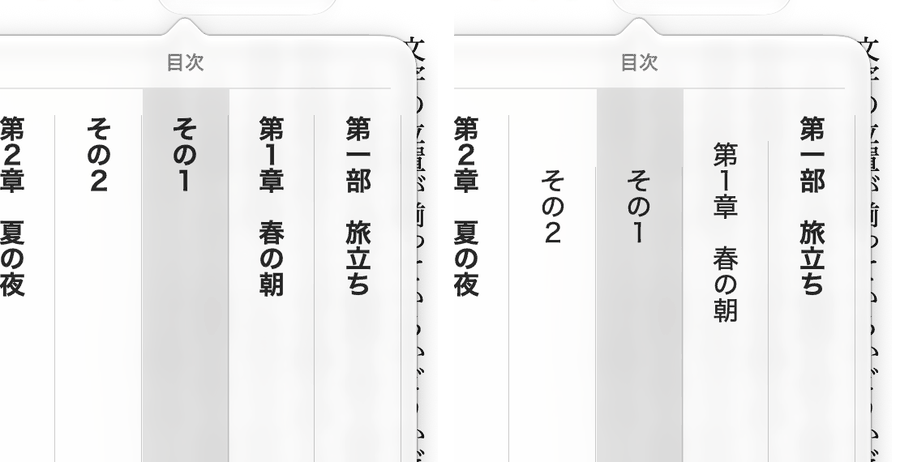
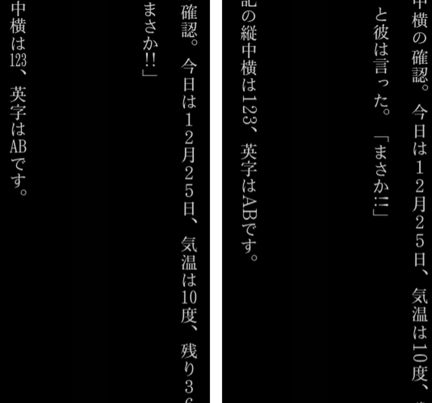
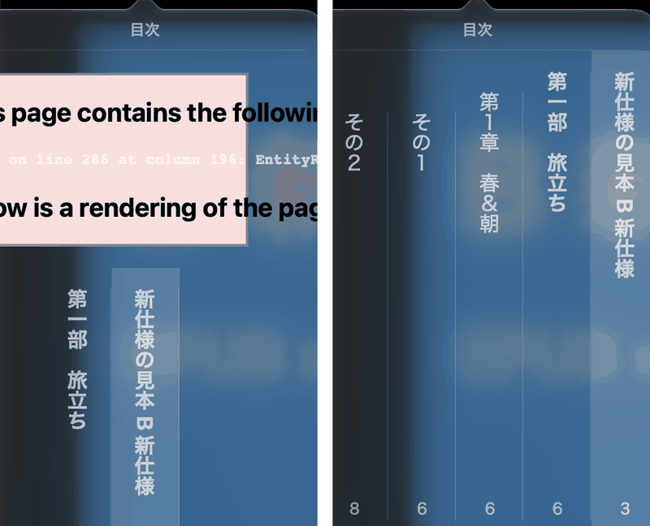
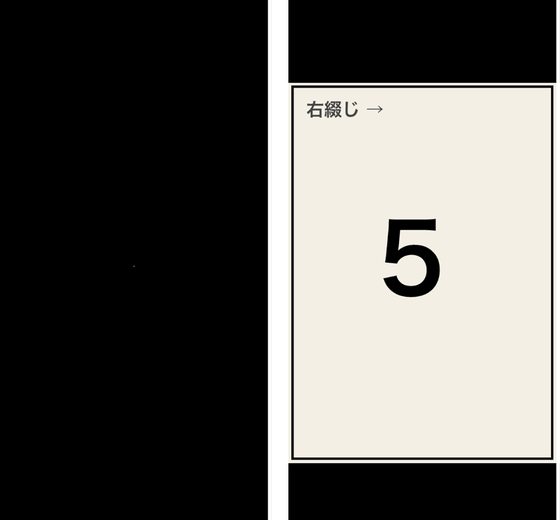

<nav style="background: #f6f8fa; padding: 1em; margin-bottom: 2em; border-radius: 6px;">
  <strong>📚 Documentation:</strong>
  <a href="index.html">Home</a> | 
  <a href="usage.html">Usage</a> | 
  <a href="gaiji-settings.html">Gaiji Settings</a> | 
  <a href="narou-setup.html">narou.rb Setup</a> |
  <a href="narou-rs-setup.html">narou.rs</a> |
  <a href="development.html">Development</a> | 
  <strong>EPUB 3.3</strong> |
  <a href="https://github.com/AozoraEpub3-JDK21/AozoraEpub3-JDK21">GitHub</a>
  
🌐 <a href="../epub33-ja.html">日本語</a>

</nav>

## EPUB 3.3 and 3.4 Support

How the EPUB written by AozoraEpub3-JDK21 relates to EPUB 3.3 and the EPUB 3.4 draft, as of v1.8.0-jdk21 (November 2026).

Specifications referred to:

- [EPUB 3.3](https://www.w3.org/TR/epub-33/) (W3C Recommendation, 13 January 2026)
- [EPUB 3.4](https://www.w3.org/TR/epub-34/) (W3C Candidate Recommendation Draft, 28 October 2026. **A draft, so it may still change**)
- [EPUB Reading Systems 3.4](https://www.w3.org/TR/epub-rs-34/) (W3C Candidate Recommendation Draft, 21 July 2026)

---

## Policy

**Books made today should still be safe to keep in the future. Within that, keep as much compatibility with older readers as possible.**

- The default output follows the newer specifications
- A setting brings back the older form for readers that need it
- Where a real reader relies on an older feature, it stays, whatever the specification calls it
- Output for devices that could not be checked here (Kobo) keeps the earlier form

---

## Feature status in the specifications

| Status | Meaning | Conformance checkers |
|---|---|---|
| **legacy** (3.3) | Kept only for EPUB 2 reading systems. Allowed, but EPUB 3 reading systems do not use it | Do not warn about its presence |
| **outdated** (3.4 draft) | Not recommended, but kept because removing it would make a large base of existing books non-conforming. Legacy features are listed here too | Do not warn about its presence |
| **deprecated** (3.3 and 3.4 draft) | Should not be used, and has limited support in reading systems | Warn about it |

The EPUB Reading Systems 3.4 draft says that **reading systems must not support legacy features in content that conforms to EPUB 3.4**.

---

## Status in AozoraEpub3-JDK21

"Default" is the default output of v1.8.0-jdk21. "Compatibility setting" is "Elements for older readers" on the TOC tab (`LegacyOutput=1` in the ini).

| Feature | 3.3 | 3.4 draft | Default | Compatibility setting, Kobo output, `.mobi` | Reason |
|---|---|---|---|---|---|
| Cover `<meta name="cover">` | legacy | outdated | not written | written | Leaving it out did not change the cover, opening position or contents in four readers |
| `toc.ncx` (NCX) | legacy | outdated | not written | written | Same. All four readers used the NAV for the contents |
| `<guide>` | legacy | outdated | written | written | Google Play Books uses it for where a book opens ([below](#reader-differences)) |
| Other OPF 2 `<meta>` (`primary-writing-mode`, `original-resolution` in image-only books, and others) | legacy | outdated | written | written | In an image-only book without `viewport`, removing them cut off the right edge in Kindle Previewer (not with `viewport`). Which `meta` causes it was not narrowed down, so they stay. Not checked for text books |
| `-epub-text-combine` (tate-chu-yoko) | deprecated | deprecated | written | written | Google Play Books does not set tate-chu-yoko without it. The standard `text-combine-upright` is written as well |
| `-epub-writing-mode`, `-epub-text-orientation`, `-epub-text-emphasis-*`, `-epub-line-break`, `-epub-word-break` | prefixed properties kept in 3.3 | outdated | written | written | Kept for older readers, with the unprefixed standard properties as well. In a test without the prefixes, emphasis dots, upright text and ruby looked the same in all four readers |
| `rendition:spread` (image-only books) | normal | outdated | written (`landscape`) | written | Removing it from an image-only book changed nothing in Apple Books or Google Play Books. Kept as the spread setting |

Not used in the output: `rendition:viewport` (deprecated), `bindings`, `switch` and `epub:trigger` (deprecated), `collection` (outdated in the 3.4 draft), and font obfuscation (the same).

### What changed in v1.8.0-jdk21

- The cover `<meta>` and `toc.ncx` are no longer written by default
- The contents hierarchy is now in the NAV. Before, it was only in `toc.ncx`, which no reader used
- Tate-chu-yoko has the standard `text-combine-upright` as well
- Image-only books have a `viewport` of the same size on every page (this was an error in the EPUB checker)
- Accessibility metadata is added. It does not claim conformance to an accessibility standard

---

<h2 id="reader-differences">Differences between readers (measured)</h2>

Measured in November 2026 in these readers. Readers can change their behaviour in updates.

- Apple Books (macOS)
- Google Play Books 2026.10.2.1 (Android)
- Thorium 3.5.1 (Windows)
- Kindle Previewer 4.0.3.0 (Windows; Tablet, Phone and E-reader)

| What was checked | Result |
|---|---|
| Contents hierarchy | All four used the NAV contents and not the hierarchy in `toc.ncx` |
| Removing `-epub-text-combine` | Only Google Play Books lost tate-chu-yoko. `text-combine-upright` and the `-webkit-` property did not set it. The other three did not change |
| Removing `<guide>` | Google Play Books opened the book at the cover instead of the body. Thorium and Kindle Previewer did not change. Not checked in Apple Books |
| Removing the cover `<meta>` and `toc.ncx` | No change in any of the four to the cover (thumbnail), opening position, contents or first pages. Kindle Previewer's Book Information shows NCX as Specified even without `toc.ncx` |
| `&`, `<` or `]]>` in a contents entry | Apple Books shows an error in its contents panel and the page numbers disappear (the EPUB checker passes). v1.8.0-jdk21 makes those characters full-width in contents entries only |
| Nested contents in Kindle Previewer | Nested entries are shown closed |
| Image-only book with a different `viewport` size per page | Apple Books cut off pages with a different shape from the first page. With one size for the whole book, none of the four cut anything off |

### What it looks like

All screenshots are of books made for testing this app.

*Apple Books contents panel. Left: output up to v1.7.6 (flat). Right: output with the hierarchy in the NAV.*

*Tate-chu-yoko in Google Play Books. Left: with `-epub-text-combine`. Right: only the standard `text-combine-upright`. On the right, "123", "AB" and "!!" do not fit in one character cell.*

*Where Google Play Books opens a book. Left: without `<guide>` (opens at the cover). Right: with `<guide>` (opens at the body).*

*Apple Books contents panel. Left: a book with `&` in an entry. Right: the same book with the full-width `＆`. On the left an error is shown, and entries and page numbers stop part way.*

*An image-only book in Apple Books (two-page spread). Left: v1.7.6 output, cut off at the top and bottom. Right: output with `viewport`.*

*An image-only book in Google Play Books. Left: v1.7.6 output, no picture. Right: output with `viewport`.*

### Not checked

- Kobo devices (Kobo output keeps the earlier form)
- Kindle devices and Send to Kindle
- Apple Books on iPhone and iPad
- Other readers

---

## Related Resources

- [EPUB 3.3 (W3C)](https://www.w3.org/TR/epub-33/)
- [EPUB 3.4 (W3C draft)](https://www.w3.org/TR/epub-34/)
- [EPUB Reading Systems 3.4 (W3C draft)](https://www.w3.org/TR/epub-rs-34/)
- [EBPAJ EPUB 3 Production Guide (Japanese)](https://dpfj.or.jp/counsel/guide)
- [epubcheck](https://github.com/w3c/epubcheck)

---

[Back to Home](index.html){:.btn}
