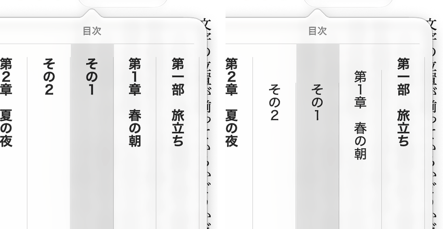
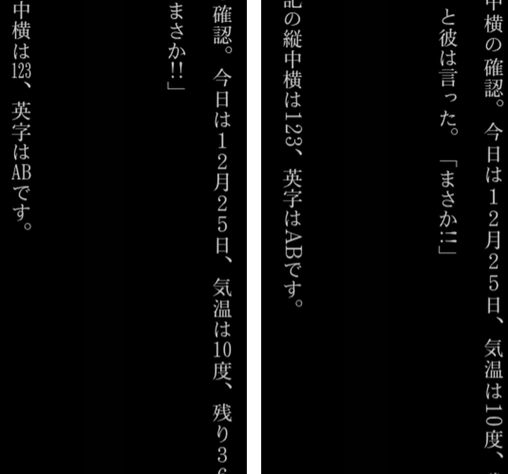
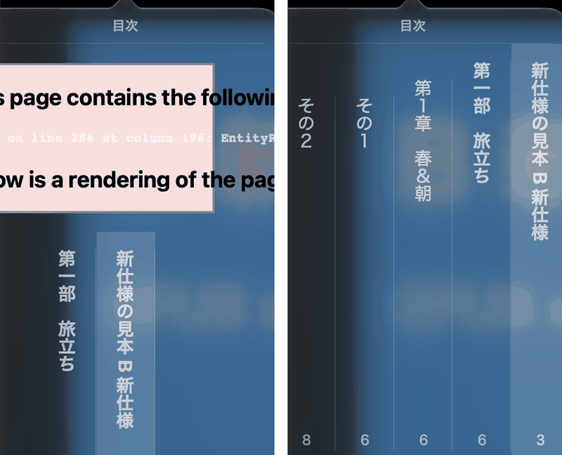
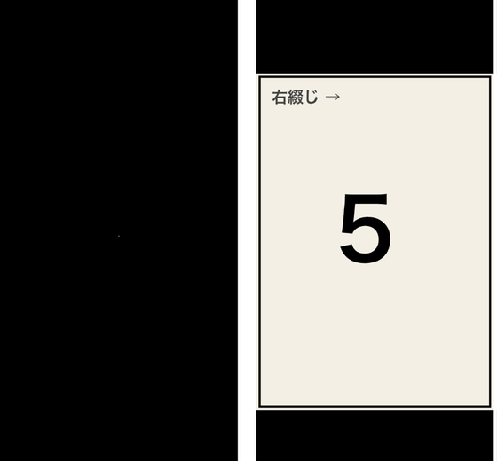

<nav style="background: #f6f8fa; padding: 1em; margin-bottom: 2em; border-radius: 6px;">
  <strong>📚 ドキュメント:</strong>
  <a href="./">ホーム</a> | 
  <a href="usage.html">使い方</a> | 
  <a href="gaiji-settings.html">外字の設定</a> | 
  <a href="narou-setup.html">narou.rb</a> |
  <a href="narou-rs-setup.html">narou.rs</a> |
  <a href="development.html">開発者向け</a> | 
  <strong>EPUB 3.3準拠</strong> |
  <a href="https://github.com/AozoraEpub3-JDK21/AozoraEpub3-JDK21">GitHub</a>
  
🌐 <a href="en/epub33.html">English</a>

</nav>

## EPUB 3.3 と 3.4 への対応

AozoraEpub3-JDK21 が出力する EPUB について、EPUB 3.3 と EPUB 3.4（草案）への対応方針と状況をまとめています。
v1.8.0-jdk21（2026 年 11 月）時点の内容です。

参照した仕様:

- [EPUB 3.3](https://www.w3.org/TR/epub-33/)（W3C 勧告、2026 年 1 月 13 日版）
- [EPUB 3.4](https://www.w3.org/TR/epub-34/)（W3C 候補勧告草案、2026 年 10 月 28 日版。**草案なので今後変わることがあります**）
- [EPUB Reading Systems 3.4](https://www.w3.org/TR/epub-rs-34/)（W3C 候補勧告草案、2026 年 7 月 21 日版）

---

## 方針

**今作る本を、将来も安心して残せる形にする。そのうえで、古いリーダーとの互換性をできるだけ保つ。**

- 既定の出力は、新しい仕様に沿った形にします
- 古い形式が必要なリーダーのために、設定で戻せるようにします
- 実際のリーダーが古い指定に頼っている場合は、仕様上の区分にかかわらず残します
- 手元で確かめられない端末（Kobo）向けの出力は、従来の形のままにします

---

## 仕様での区分

EPUB には、古くなった要素を表す区分があります。

| 区分 | 意味 | 検査ツール |
|---|---|---|
| **legacy**（3.3） | EPUB 2 のリーダーのためだけに残された要素。含めてもよいが、EPUB 3 のリーダーは使わない | 含まれていても警告しない |
| **outdated**（3.4 草案） | 推奨されないが、廃止すると既存の本の多くが仕様に適合しなくなるため残されている要素。legacy の要素も含む | 含まれていても警告しない |
| **deprecated**（3.3・3.4 草案） | 使うべきでない要素。リーダーの対応も限られる | 警告する |

EPUB Reading Systems 3.4 の草案では、**リーダーは、3.4 に準拠した本に含まれる legacy の要素をサポートしてはならない**とされています。

---

## 対応状況

「既定」は v1.8.0-jdk21 の既定の出力です。「互換設定」は目次タブの「古いリーダー向けの要素」（INI では `LegacyOutput=1`）です。

| 要素 | 3.3 | 3.4 草案 | 既定 | 互換設定・Kobo 向け・`.mobi` | 理由 |
|---|---|---|---|---|---|
| 表紙の `<meta name="cover">` | legacy | outdated | 出さない | 出す | 4 つのリーダーで、出力しなくても表紙・開く位置・目次が変わらなかった |
| `toc.ncx`（NCX） | legacy | outdated | 出さない | 出す | 同上。目次は 4 つとも NAV を使っていた |
| `<guide>` | legacy | outdated | 出す | 出す | Google Play ブックスが本を開く位置の指定に使っている（[下記](#reader-differences)） |
| そのほかの OPF 2 の `<meta>`（`primary-writing-mode`、画像だけの本の `original-resolution` など） | legacy | outdated | 出す | 出す | 画像だけの本で、`viewport` がない状態で外すと Kindle Previewer で右端が切れた（`viewport` があると切れない）。どの `meta` が原因かは切り分けていないので残す。文字の本では確かめていない |
| `-epub-text-combine`（縦中横） | deprecated | deprecated | 出す | 出す | Google Play ブックスはこれがないと縦中横にならない。標準の `text-combine-upright` も併記 |
| `-epub-writing-mode`、`-epub-text-orientation`、`-epub-text-emphasis-*`、`-epub-line-break`、`-epub-word-break` | 3.3 で残された接頭辞付きの指定 | outdated | 出す | 出す | 古いリーダーのために残す。接頭辞のない標準の指定も併記。接頭辞を外した試作でも、傍点・正立・ルビの表示は 4 つのリーダーとも変わらなかった |
| `rendition:spread`（画像だけの本） | 通常 | outdated | 出す（`landscape`） | 出す | 画像だけの本で外しても、Apple Books と Google Play ブックスの表示は変わらなかった。見開きの指定として残す |

次の要素は出力に使っていません: `rendition:viewport`（deprecated）、`bindings`・`switch`・`epub:trigger`（deprecated）、`collection`（3.4 草案で outdated）、フォントの難読化（同）。

### v1.8.0-jdk21 で変えたこと

- 表紙の `<meta>` と `toc.ncx` を、既定では出力しないようにしました
- 目次の階層を NAV に出力するようにしました。それまでは `toc.ncx` にしか階層がなく、どのリーダーも使っていませんでした
- 縦中横に標準の `text-combine-upright` を加えました
- 画像だけの本では、全ページに同じ大きさの `viewport` を指定しました（EPUB の検査でエラーになっていた箇所です）
- アクセシビリティのメタデータを追加しました。規格への適合を表明するものではありません

---

<h2 id="reader-differences">リーダーごとの違い（実測）</h2>

2026 年 11 月に、次のリーダーで動作を確かめた結果です。リーダーの更新で挙動が変わることがあります。

- Apple Books（macOS）
- Google Play ブックス 2026.10.2.1（Android）
- Thorium 3.5.1（Windows）
- Kindle Previewer 4.0.3.0（Windows）の Tablet・Phone・E-reader

| 内容 | 結果 |
|---|---|
| 目次の階層 | 4 つとも NAV の目次を使い、`toc.ncx` の階層は使わなかった |
| `-epub-text-combine` を外す | Google Play ブックスだけ縦中横が崩れた。`text-combine-upright` や `-webkit-` の指定では縦中横にならなかった。ほかの 3 つは変わらなかった |
| `<guide>` を外す | Google Play ブックスは、本文ではなく表紙から開くようになった。Thorium と Kindle Previewer は変わらなかった。Apple Books は確かめていない |
| 表紙の `<meta>` と `toc.ncx` を外す | 4 つとも、表紙（サムネイル）・開く位置・目次・先頭のページが変わらなかった。Kindle Previewer の Book Information では、`toc.ncx` がなくても NCX が Specified と表示される |
| 目次の項目名に `&`・`<`・`]]>` がある | Apple Books の目次パネルにエラーが出て、ページ番号も消えた（EPUB の検査は通る）。v1.8.0-jdk21 では、目次の項目名にあるこれらの文字だけ全角にしている |
| 目次の階層を Kindle Previewer で開く | 入れ子の項目は閉じた状態で表示される |
| 画像だけの本で、ページごとに `viewport` の大きさが違う | Apple Books で、先頭と形の違うページが切れた。本全体で同じ大きさにすると、4 つとも切れなくなった |

### 見た目の比較

いずれも、このアプリの試験用に作った本で撮影しました。

*Apple Books の目次パネル。左は v1.7.6 までの出力（平ら）、右は NAV に階層を出した出力。*

*Google Play ブックスの縦中横。左は `-epub-text-combine` あり、右は標準の `text-combine-upright` だけ。右では「123」「AB」「!!」が 1 文字分に収まらない。*

*Google Play ブックスで本を開いた位置。左は `<guide>` なし（表紙から開く）、右は `<guide>` あり（本文から開く）。*

*Apple Books の目次パネル。左は項目名に `&` がある本、右は同じ文字を全角の `＆` にした本。左ではエラーが出て、項目もページ番号も途中から表示されない。*

*Apple Books の画像だけの本（見開き）。左は v1.7.6 の出力で上下が切れ、右は `viewport` を入れた出力。*

*Google Play ブックスの画像だけの本。左は v1.7.6 の出力で絵が出ず、右は `viewport` を入れた出力。*

### 確かめていないもの

- Kobo の端末（Kobo 向けの出力は従来の形のままです）
- iPhone・iPad の Apple Books
- 上記以外のリーダー

---

## 参考リソース

- [EPUB 3.3（W3C）](https://www.w3.org/TR/epub-33/)
- [EPUB 3.4（W3C 草案）](https://www.w3.org/TR/epub-34/)
- [EPUB Reading Systems 3.4（W3C 草案）](https://www.w3.org/TR/epub-rs-34/)
- [電書協 EPUB 3 制作ガイド](https://dpfj.or.jp/counsel/guide)
- [epubcheck](https://github.com/w3c/epubcheck)

---

## トップへ戻る

[インストールガイドに戻る](./){:.btn}
